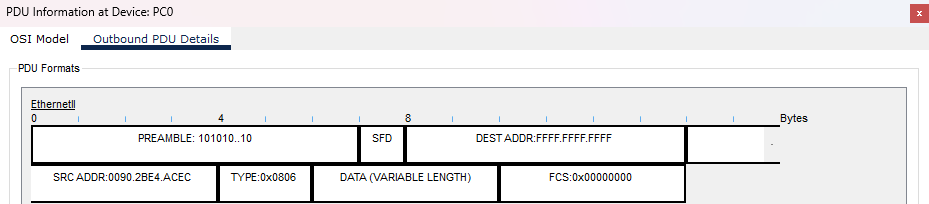

> [!IMPORTANT]  
> Если вы начали выполнять лабораторную работу до 02.10.26, то между IP-адресацией в задании и IP-адресацией в Cisco Packet Tracer Activity у вас будет расхождение (не 192.168.10.0/24, а 192.168.0.0/24 и не 192.168.20.0/25, а 192.168.1.0/25). Соответственно Activity при проверке результата покажет ошибки в части настройки адресов. Можете не исправлять, сохраняйте как есть, я приму такой вариант. 

# Теория по теме работы

1. https://networkeducation.ru/video/course/ipv4/
2. https://netacad.sadlab.su/itn-dl/?lng=ru-RU
3. https://pc.ru/articles/osnovy-raboty-s-cisco-packet-tracer

# Пример отчета

````markdown
# Отчет по лабораторной работе 1.1
**Тема:** Базовая настройка, ARP, статическая маршрутизация  
**Выполнил:** Иванов И. И., гр. ИВТ-21  

## Часть 1: Создание топологии и начальная конфигурация устройств

### Шаг 1

Собрали схему в Packet Tracer и соединили устройства по таблице портов.


Настроили статические IP-адреса, маски и шлюзы на компьютерах `PC0`, `PC1` и `PC2`.

  
  
  

Через консоль выполнили базовую настройку `R1`, `R2` и `SW1` (задали hostname, пароли, шифрование, параметры консоли и IP на интерфейсах), после чего сохранили конфиг.

```
тут должен быть листинг команд
```

### Шаг 2

Проверили доступность узлов командой `ping` с `PC0` до `PC1` и `PC2`. Посмотрели таблицы MAC на `SW1` и ARP на `PC0` и `R1`.

```
тут должен быть листинг команд
```

**Ответы на вопросы:**
1. [Ваш ответ о результатах проверки связности]
2. [Ваше описание содержимого таблицы коммутации на SW1]
3. [Ваше описание содержимого таблиц ARP на PC0 и R1]

## Часть 2: Роль IP и MAC адреса при прямой и косвенной пересылке

### Шаг 1

Перешли в режим симуляции, настроили фильтр на протокол `ICMP` и отправили пинг с `PC0` на `PC2`.


### Шаг 2

Открыли пакет на `PC0` и изучили заголовки.


* **DEST MAC:** [Указать, чей MAC-адрес указан в кадре и объяснить, почему]

Прогнали симуляцию до `R1` и посмотрели `Outbound PDU Details`.


* **SRC и DEST MAC:** [Указать адреса и объяснить, почему они изменились]

````