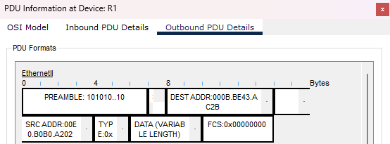
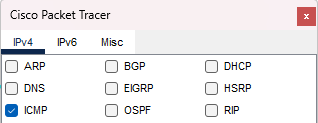

> [!IMPORTANT]  
> Если вы начали выполнять лабораторную работу до 02.10.26, то между IP-адресацией в задании и IP-адресацией в Cisco Packet Tracer Activity у вас будет расхождение (не 192.168.10.0/24, а 192.168.0.0/24 и не 192.168.20.0/25, а 192.168.1.0/25). Соответственно Activity при проверке результата покажет ошибки в части настройки адресов. Можете не исправлять, сохраняйте как есть, я приму такой вариант. 

# Теория по теме работы

1. https://networkeducation.ru/video/course/ipv4/
2. https://netacad.sadlab.su/itn-dl/?lng=ru-RU
3. https://pc.ru/articles/osnovy-raboty-s-cisco-packet-tracer

# Пример отчета

````markdown
# Отчет по лабораторной работе №N
**Тема:** Тема работы
**Выполнил:** Иванов И. И., гр. ИВТ-21  

## Топология



## Ответы на вопросы

1. Ответ на вопрос.
2. Ответ на вопрос.
Продолжение ответа.
```text
тут должен быть листинг команд
```
3. Ответ на вопрос.


````
