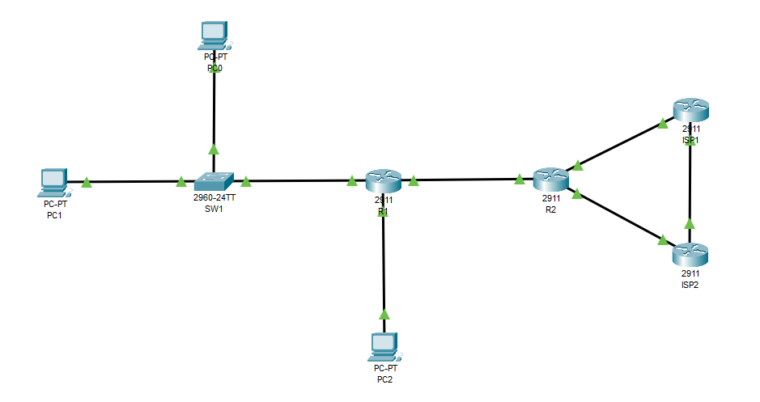
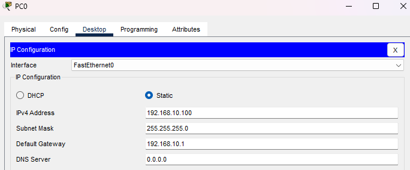
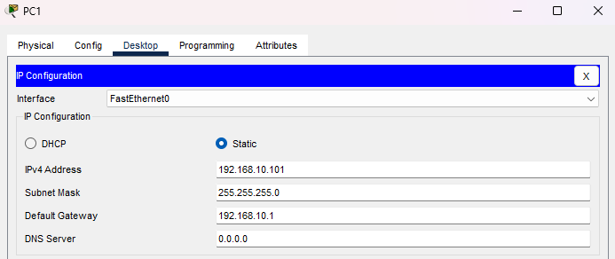
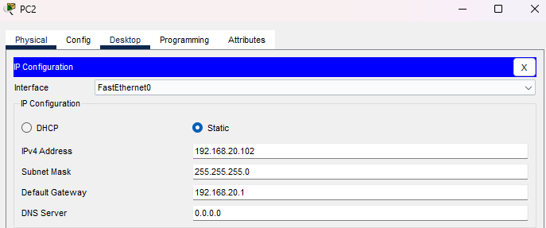
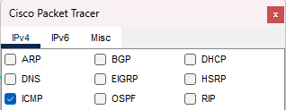
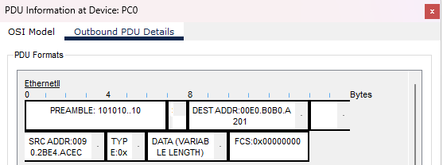
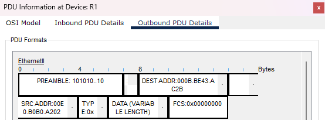
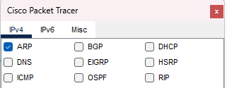
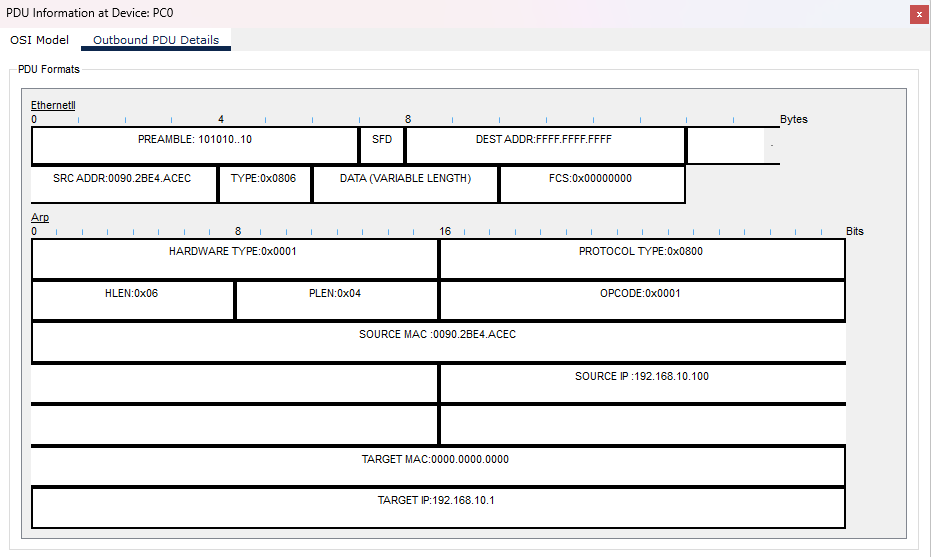
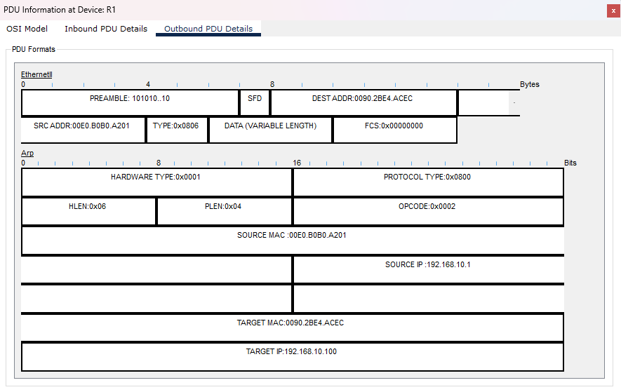

# Отчёт по лабораторной работе 1.1
**Тема:** Базовая настройка, ARP, статическая маршрутизация  
**Выполнил:** Малыгин А. С., гр. 539

## Часть 1: Создание топологии и начальная конфигурация устройств

### Шаг 1

Создал топологию в CPT и соединил устройства в соответствии с таблицей.



Настроил static IP, маски и шлюзы на "PC0", "PC1", "PC2".





Через консоль выполнил настройку "R1", "R2", "SW1".

```
Для R1:
en
conf t
no ip domain-lookup
hostname R1
enable secret cisco
service password-encryption
username admin privilege 15 secret cisco
line console 0
logging synchronous
login local
speed 115200
exit
int g0/0 
ip address 192.168.10.1 255.255.255.0
description LAN1
no sh
exit
int g0/1
ip add 192.168.20.1 255.255.255.128
description LAN2
no sh
exit
int g0/2
ip add 10.10.12.2 255.255.255.252
description UPLINK
no sh
exit
exit
write
```
```
Для R2:
en
conf t
no ip domain-lookup
hostname R2
enable secret cisco
service password-encryption
username admin privilege 15 secret cisco
line console 0
logging synchronous
login local
speed 115200
exit
int g0/0 
ip add 100.0.102.130 255.255.255.252
description ISP1
no sh
exit
int g0/1
ip add 100.0.202.130 255.255.255.252
description ISP2
no sh
exit
int g0/2
ip add 10.10.12.1 255.255.255.252
description DOWNLINK
no sh
exit
exit
write
```
```
Для SW1:
en
conf t
no ip domain-lookup
hostname SW1
enable secret cisco
service password-encryption
username admin privilege 15 secret cisco
line console 0
logging synchronous
login local
speed 115200
exit
int vlan1
ip add 192.168.10.254 255.255.255.0
description MGMT
no sh
exit
ip default-gateway 192.168.10.1	
exit
write
```
### Шаг 2
Проверил связность хостов, отправив эхо-запросы с PC0 на PC1 и PC2:
```
ping 192.168.10.101
ping 192.168.20.102
```
**Ответы на вопросы:**
1. **Эхо-запросы проходят успешно?**   
Запросы на PC1 прошли успешно и без потерь, т.к. хосты находятся в одной сети и RTT короткое => ARP и ICMP успевают вернуться до тайм-аута;  
   Первый запрос на PC2 выдал тайм-аут из-за ARP-запроса и длительного RTT (ICMP не успел пройти путь), остальные 3 получены, а TTL изменён с 128 на 127 (R1). Повторный эхо-запрос на PC2 уже проходит без потерь, т.к. ARP-таблица заполнена и ICMP хватает времени.
2. **Как выглядит таблица коммутации на SW1 после проверки?**  
```
Vlan    Mac Address       Type        Ports
----    -----------       --------    -----

   1    0040.0b29.98d1    DYNAMIC     Fa0/11
   1    0090.2be4.acec    DYNAMIC     Fa0/10
   1    00e0.b0b0.a201    DYNAMIC     Gig0/1
```  
MAC-адреса PC0, PC1, R1.

3. **Как выглядит таблица ARP на PC0? На R1?**  
```
  Internet Address      Physical Address      Type
  192.168.10.1          00e0.b0b0.a201        dynamic
  192.168.10.101        0040.0b29.98d1        dynamic
```
ARP-таблица PC0: MAC-адреса  R1, PC1  
```
  Protocol  Address          Age (min)  Hardware Addr   Type   Interface
  Internet  10.10.12.2              -   00E0.B0B0.A203  ARPA   GigabitEthernet0/2
  Internet  192.168.10.1            -   00E0.B0B0.A201  ARPA   GigabitEthernet0/0
  Internet  192.168.10.100          2   0090.2BE4.ACEC  ARPA   GigabitEthernet0/0
  Internet  192.168.20.1            -   00E0.B0B0.A202  ARPA   GigabitEthernet0/1
  Internet  192.168.20.102          2   000B.BE43.AC2B  ARPA   GigabitEthernet0/1
```
ARP-таблица R1: MAC-адреса PC0, PC2, R2; On-link LAN1, 2.  

## Часть 2: Роль IP и MAC адреса при прямой и косвенной пересылке

### Шаг 1:
Перешёл в режим симуляции, в фильтрах событий убрал всё, кроме ICMP, отправил эхо-запрос с PC0 на PC2  

```
ping 192.168.20.102
```
### Шаг 2:
**Ответы на вопросы:**
1. **MAC-адрес какого устройства указан в DEST MAC Ethernet-кадра? Почему?**  
  
В MAC-адресе назначения указан входной интерфейс R1. Поскольку PC2 находится в другой сети, то PC0 отправляет пакет на шлюз по умолчанию (R1), но по пути к R1 стоит SW1, которому нужен MAC-адрес, чтобы понять куда пересылать пакет дальше  
2. **Пролистайте Events до момента, когда сообщение достигнет R1. Изучите Outbound PDU Details.  
SRC и DEST MAC-адреса каких устройств указаны в Ethernet-кадре? Почему?**  
  
MAC-адрес источника указан интерфейс R1, выходящий к PC2, а в MAC-адресе назначения указан сам PC2. Предыдущий MAC-адрес источника был на интерфейсе, не связанном с PC2, поэтому он поменялся. MAC-адрес назначения нужен, чтобы сетевая карта PC2 поняла, что кадр предназначен ей и начала его обрабатывать, иначе она просто удалила бы кадр.

## Часть 3: Протокол ARP

### Шаг 1:
Вышел из режима симуляции, очистил ARP-таблицу PC0, зашёл в режим симуляции и выбрал фильтр ARP, отправил эхо-запрос с PC0 на R1.  

```
arp -d
arp -a (проверка всё ли удалено)
ping 192.168.10.1
```

### Шаг 2:
**Изучите сообщение протокола ARP, созданное на PC0 и ответьте на вопросы:**  

1. **Какой TYPE указан в Ethernet-кадре?**    
TYPE:0x0806 - протокол ARP.
2. **Какой DEST MAC-адрес указан в Ethernet-кадре? Как он называется? Как поступит SW1, когда получит этот кадр?**  
Указан *<ins>широковещательный</ins>* MAC-адрес FFFF.FFFF.FFFF. Когда SW1 получит кадр, он перешлёт его всем подключенным узлам, кроме узла отправителя, и запишет MAC-адрес отправителя в таблицу.
3. **Какой OPCODE указан в заголовке ARP?**  
OPCODE:0x0001 - ARP-запрос (request).
4. **SOURCE MAC и SOURCE IP какого устройства указаны в заголовке ARP?**  
Указаны Src. MAC и Src. IP PC0 - отправителя эхо-запроса. 
5. **Какой TARGET MAC? Почему?**  
MAC-назначения 0000.0000.0000. Поскольку MAC-адрес ещё неизвестен, используются нули как заполнитель.  

**Пролистайте Events до момента, когда сообщение достигнет R1. Изучите Outbound PDU Details и ответьте на вопросы:**  

1. **DEST MAC-адрес какого устройства указан в Ethernet-кадре? Как поступит SW1, когда получит этот кадр?**  
Указан MAC-адрес PC0, SW1 отправит этот кадр Unicast-ом на PC0, т.к. записал MAC-адрес PC0 в таблице коммутации.
2. **Какой OPCODE указан в заголовке ARP?**  
OPCODE:0x0002 - ARP-ответ (reply).
3. **Кому принадлежат SOURCE MAC, SOURCE IP и TARGET MAC, TARGET IP.**  
Src. MAC и Src. IP - принадлежат R1 (Src. MAC выходящего к SW1 интерфейса); Dest. MAC и Dest. IP - принадлежат PC0.

## Часть 4: Настройка статической маршрутизации

### Шаг 1:
Вышел из режима симуляции и создал на **R1** рекурсивный маршрут по умолчанию через R2.
```
ip route 0.0.0.0 0.0.0.0 10.10.12.1 
```
На **R2** создал агрегированный рекурсивный маршрут по умолчанию до сетей LAN1 и LAN2 через R1;  
Рекурсивный маршрут по умолчанию через ISP1;  
Рекурсивный плавающий маршрут по умолчанию (административная дистанция - 10) через ISP2.
```
ip route 192.168.0.0 255.255.224.0 10.10.12.2
ip route 0.0.0.0 0.0.0.0 100.0.102.129
ip route 0.0.0.0 0.0.0.0 100.0.202.129 10
```
### Шаг 2:  
Отправил эхо-запрос с PC0 на IP 8.8.8.8, потерь нет, ISP1 поменял TTL со 126 на 255, итоговый TTL = 253  
```
Pinging 8.8.8.8 with 32 bytes of data:

Reply from 8.8.8.8: bytes=32 time<1ms TTL=253
Reply from 8.8.8.8: bytes=32 time=1ms TTL=253
Reply from 8.8.8.8: bytes=32 time<1ms TTL=253
Reply from 8.8.8.8: bytes=32 time<1ms TTL=253

Ping statistics for 8.8.8.8:
    Packets: Sent = 4, Received = 4, Lost = 0 (0% loss),
Approximate round trip times in milli-seconds:
    Minimum = 0ms, Maximum = 1ms, Average = 0ms
```

**Посмотрите таблицу маршрутизации на R2. Какой Next-hop указан для маршрута по умолчанию?**  
100.0.102.129 - IP-адрес ISP1 g0/0 интерфейса;  
```
Gateway of last resort is 100.0.102.129 to network 0.0.0.0

S*   0.0.0.0/0 [1/0] via 100.0.102.129
```
Отключил на R2 интерфейс g0/0, теперь указан 100.0.202.129 - IP-адрес ISP2 g0/0 интерфейса, с AD = 10
```
Gateway of last resort is 100.0.202.129 to network 0.0.0.0

S*   0.0.0.0/0 [10/0] via 100.0.202.129
```